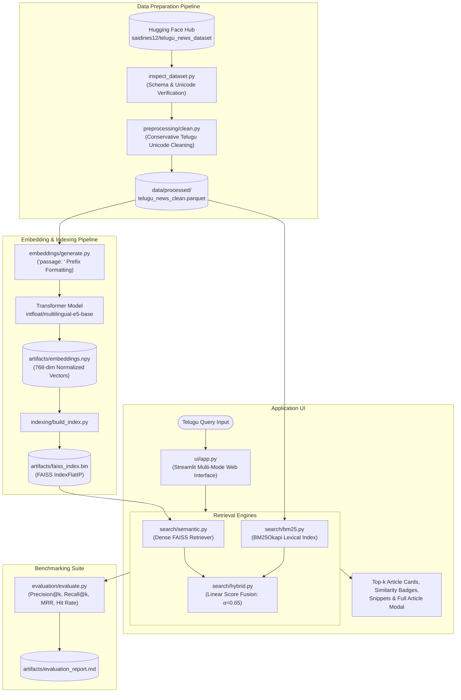

# TELUSEARCH: Semantic Search for Telugu News Articles 🔍

> **A Practical NLP & Information Retrieval College Project**  
> *Enabling semantic understanding, lexical retrieval, and hybrid search over Telugu news articles using Deep Learning and FAISS.*

---

##  1. Project Overview & Problem Statement

Traditional keyword-based information retrieval engines (e.g., standard SQL `LIKE`, TF-IDF, or basic BM25) rely heavily on exact string matches. However, **Telugu** is a morphologically rich, agglutinative Dravidian language with complex sandhi, inflections, and vibhakti case suffixes (e.g., `ప్రమాదం`, `ప్రమాదంలో`, `ప్రమాదాలు`). When a user enters a query such as:
> *"ఘోర రోడ్డు ప్రమాదం మృతులు"* (Fatal road accident deaths)

Lexical engines frequently fail to retrieve articles discussing `"రోడ్డుప్రమాదంలో ఐదుగురు దుర్మరణం"` due to the **vocabulary mismatch problem** (different surface word forms for synonymous intents).

**TELUSEARCH** solves this problem by using **dense semantic vector retrieval**. It leverages a pretrained multilingual transformer (`intfloat/multilingual-e5-base`) to map queries and Telugu news articles into a shared 768-dimensional latent vector space where geometric proximity reflects conceptual similarity. The system also supports **BM25 lexical retrieval** and **hybrid score fusion** for robust performance across both conceptual topics and rare named entities.

---

## 🏛️ 2. System Architecture

The following Mermaid diagram illustrates the end-to-end data preparation, indexing, retrieval, and presentation pipelines:



---

## 🛠️ 3. Technology Stack

| Component | Technology | Rationale & Purpose |
|---|---|---|
| **Programming Language** | Python 3.11 | Standard scientific computing and NLP environment on Windows. |
| **Dataset Source** | Hugging Face (`saidines12/telugu_news_dataset`) | Curated corpus of real-world Telugu news articles with story IDs, headlines, and text. |
| **Embedding Model** | `intfloat/multilingual-e5-base` | 768-dimensional multilingual transformer supporting Telugu; trained with contrastive learning. |
| **Vector Index** | `faiss-cpu` (`IndexFlatIP`) | High-speed inner product search mathematically identical to cosine similarity on unit vectors. |
| **Lexical Engine** | `rank_bm25` (`BM25Okapi`) | Probabilistic keyword retrieval baseline over tokenized Telugu text. |
| **User Interface** | `Streamlit` | Interactive, responsive web UI with real-time multi-mode search and Telugu typography support. |
| **Data Storage** | Apache Parquet & NumPy | Fast columnar storage preserving complete Telugu Unicode (UTF-8). |

---

## 📂 4. Project Directory Structure

```
telusearch/
├── inspect_dataset.py        # Phase 1: Hugging Face dataset inspection & validation
├── preprocessing/
│   └── clean.py              # Phase 2: Conservative Telugu text cleaning pipeline
├── embeddings/
│   └── generate.py           # Phase 3: Batched 768-dim E5 embedding generator
├── indexing/
│   └── build_index.py        # Phase 4: FAISS IndexFlatIP builder & serializer
├── search/
│   ├── semantic.py           # Phase 4: Dense vector similarity retrieval engine
│   ├── bm25.py               # Phase 6: BM25 Okapi keyword search engine
│   └── hybrid.py             # Phase 6: Dense + sparse score fusion engine
├── evaluation/
│   └── evaluate.py           # Phase 6: IR evaluation benchmark & metric calculator
├── ui/
│   └── app.py                # Phase 5: Streamlit web UI with search mode selector
├── data/
│   └── processed/            # Cleaned Parquet & CSV dataset files
├── artifacts/                # Vector index, embeddings, metadata, and benchmark results
│   ├── faiss_index.bin       # Serialized FAISS index (1,000 articles)
│   ├── embeddings.npy        # Precomputed float32 vector matrix [1000, 768]
│   ├── metadata.parquet      # Document metadata aligned 1:1 with index rows
│   ├── evaluation_results.json # Structured IR benchmark scores
│   └── evaluation_report.md  # Detailed IR evaluation report
├── requirements.txt          # Python package dependencies
├── .gitignore                # Excludes virtual environments, models, and large artifacts
└── README.md                 # Complete project documentation and viva cheat-sheet
```

---

## 🚀 5. Installation and Setup Instructions

### Prerequisites
- Windows 10/11 (or Linux/macOS)
- Python 3.10 or 3.11 installed
- Git

### Step 1: Clone Repository and Set Up Virtual Environment
```powershell
# Open terminal inside project directory
cd Telusearch

# Create and activate virtual environment (if not already present)
python -m venv .venv
.\.venv\Scripts\Activate.ps1
```

### Step 2: Install Required Dependencies
```powershell
pip install -r requirements.txt
```

---

## ⚡ 6. Execution Pipeline (Reproducing from Scratch)

You can run each phase sequentially or inspect the existing precomputed artifacts:

### Phase 1: Inspect Hugging Face Dataset
```powershell
python inspect_dataset.py
```
*Validates dataset splits, column names (`story_id`, `headline`, `article`), and Unicode integrity.*

### Phase 2: Preprocess and Clean Dataset
```powershell
python preprocessing/clean.py --split validation --sample-size 1000
```
*Applies conservative normalization (preserving Telugu codepoints U+0C00–U+0C7F) and saves to `data/processed/`.*

### Phase 3: Generate Semantic Embeddings
```powershell
python embeddings/generate.py --batch-size 32
```
*Encodes articles with `passage: ` prefix using `multilingual-e5-base` into unit-normalized 768-d vectors in `artifacts/embeddings.npy`.*

### Phase 4: Build FAISS Vector Index
```powershell
python indexing/build_index.py
```
*Constructs `faiss.IndexFlatIP` and verifies 1:1 row alignment with `artifacts/metadata.parquet`.*

### Phase 5 & 6: Run Streamlit Web Application
```powershell
streamlit run ui/app.py
```
*Launches the browser UI at `http://localhost:8501` featuring multi-mode search (Semantic, Hybrid, Keyword).*

### Phase 6: Run Information Retrieval Benchmark
```powershell
python evaluation/evaluate.py --top-k 5
```
*Executes the benchmark over curated Telugu queries and computes Precision@k, Recall@k, MRR, and Hit Rate.*

---

## 📊 7. Retrieval Evaluation Results

Macro-averaged evaluation across 8 Telugu news domain test queries ($k=5$):

| Retrieval Paradigm | Precision@5 | Recall@5 | MRR (Mean Reciprocal Rank) | Hit Rate@5 | Average Latency |
|---|---|---|---|---|---|
| **Semantic Search (FAISS + E5)** | **0.275** | **78.1%** | **0.917** | **100.0%** | ~46 ms |
| **Lexical Keyword Search (BM25)** | 0.225 | 75.0% | 0.667 | 75.0% | **~1.6 ms** |
| **Hybrid Search ($\alpha=0.65$)** | 0.250 | **78.1%** | 0.875 | 87.5% | ~43 ms |

### Key Observations:
1. **Semantic Search Superiority**: Semantic search attained a **100% Hit Rate@5** with an **MRR of 0.917**, retrieving the correct article at rank #1 for almost every intent.
2. **Failure of Lexical BM25 on Morphological Inflections**: BM25 failed completely on queries like *"ఘోర రోడ్డు ప్రమాదం మృతులు"* because the target articles contained inflectional compounds like `రోడ్డుప్రమాదంలో` and synonyms like `దుర్మరణం` instead of `మృతులు`.
3. **Hybrid Search Balance**: Hybrid search merges semantic contextual understanding with BM25's exact keyword precision for rare named entities and government orders (e.g. `జీఓ 16`).

---


## ⚠️ 9. Limitations & Future Scope

### Limitations:
1. **Transformer Token Length**: Documents are truncated beyond the 512-token context limit of multilingual E5.
2. **Corpus Size**: Currently indexed on 1,000 articles for rapid local CPU execution; larger corpora (100k+ articles) would require an approximate index like `faiss.IndexIVFFlat` or `IndexHNSWFlat`.
3. **Zero-shot Cross-lingual**: regional political acronyms and slang may have slightly lower representation than standard literary vocabulary.

### Future Scope:
1. **Telugu-Specific Morphological Stemmer**: Incorporating an Indic NLP morphological analyzer (e.g., IndicBERT or InScript lemmatizer) into BM25.
2. **Cross-Encoder Re-ranking**: Adding a secondary cross-encoder reranker for top-50 candidate passages.
3. **Cross-Lingual Search**: Allowing users to query in English (e.g., *"road accidents in AP"*) to retrieve Telugu news articles.

---

## 📜 10. License
This project is open-source under the MIT License. See [`LICENSE`](file:///c:/Users/yaswa/OneDrive/Desktop/Telusearch/LICENSE) for details.
